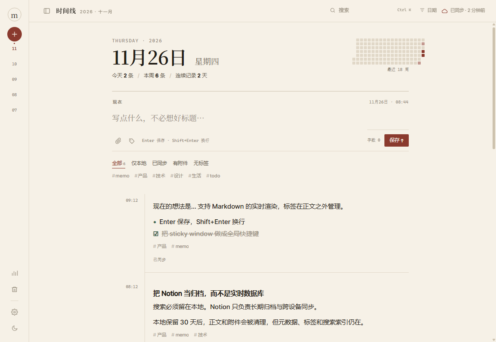
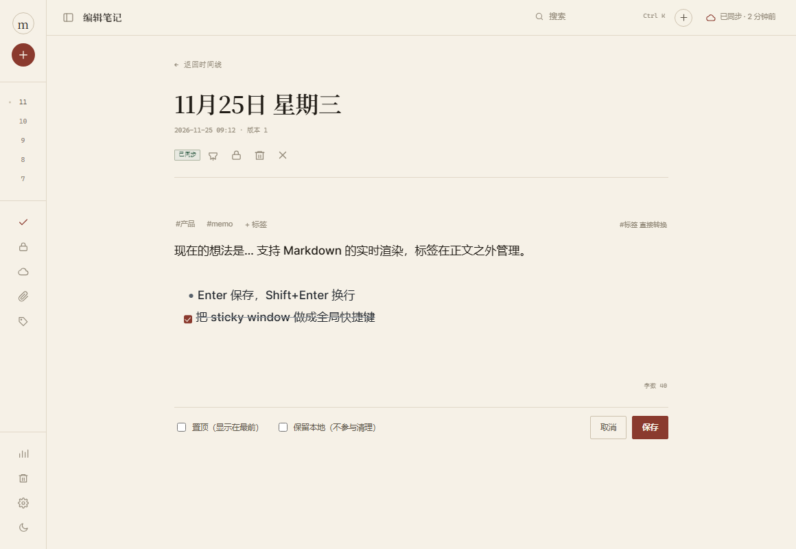
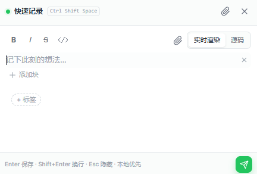
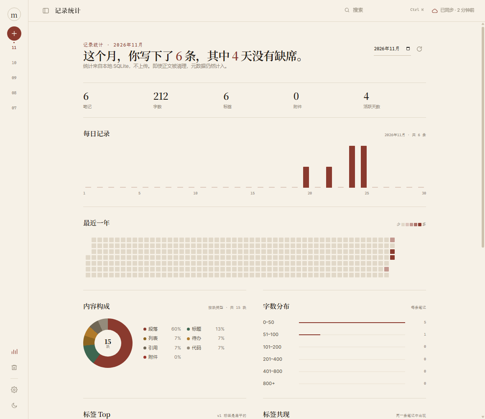

# memo

**Local-first desktop memos with an optional Notion archive.**

English | [简体中文](README.md)

[](https://github.com/olianate/memo/releases/latest)  
[](https://github.com/olianate/memo/actions/workflows/release.yml)



Notes, search, tags and statistics live in local SQLite and work offline; Notion is  
an optional long-term archive.

## Features

- Write immediately: `Enter` saves, `Shift+Enter` adds a paragraph
- Global quick capture with `Ctrl+Shift+Space`, `Esc` hides it
- Markdown blocks, tags, attachments and local search
- Trash, tray-first window and single instance
- Optional Notion archive with schema checks, sync pause and body retention

| Edit a memo | Quick capture |
| --- | --- |
|  |  |



## Download

Latest: [**Releases**](https://github.com/olianate/memo/releases/latest)

| Platform | Package |
| --- | --- |
| Windows x64 | [memo-windows-amd64.msi](https://github.com/olianate/memo/releases/latest/download/memo-windows-amd64.msi) (recommended) |
| Windows x64 | [memo-windows-amd64-installer.exe](https://github.com/olianate/memo/releases/latest/download/memo-windows-amd64-installer.exe) |
| macOS Intel / Apple Silicon | [memo-macos-universal.dmg](https://github.com/olianate/memo/releases/latest/download/memo-macos-universal.dmg) |

The builds are unsigned and not notarized; on first launch use SmartScreen  
"More info → Run anyway", or right-click → Open on macOS. Windows needs WebView2,  
macOS needs 12+.

## Usage

1. Write in the composer; type `#tag` to attach a tag. Click a card to edit its body, tags and attachments, or move it to the trash.
2. Closing the main window leaves memo in the tray; left-click the tray icon to restore.

Data lives in `%APPDATA%\memo` on Windows and `~/Library/Application Support/memo` on  
macOS. Uninstalling keeps it; use **Settings → Delete all local data** to remove it.

## Notion (optional)

Create a Notion integration and share the target page or database with it, then paste  
the token in **Settings → Connect Notion** and pick the target. Existing databases are  
schema-checked: missing properties are added after confirmation, type conflicts block  
the connection. The token is stored in the OS keychain, never in SQLite or logs.

See [`docs/development.md`](docs/development.md) for details.

## Build

Requires Go 1.26+, Node.js 24+ and the Wails v3 CLI  
(`go install github.com/wailsapp/wails/v3/cmd/wails3@v3.1.0`). Windows MSI needs  
WiX 3.14, the NSIS package needs NSIS, and macOS needs Xcode Command Line Tools.

```bash
go test ./internal/...
( cd frontend && npm ci && npm test && npx tsc --noEmit )

wails3 dev     # hot reload
wails3 build   # production build, embeds frontend/dist
```

Packaging and release (MSI / NSIS / DMG, `SHA256SUMS.txt`, the `v*` tag-triggered  
workflow) are documented in [`docs/development.md`](docs/development.md).

## Docs

- [`docs/development.md`](docs/development.md): implementation, Notion behavior and packaging
- [`GLOSSARY.md`](GLOSSARY.md): domain vocabulary
- [`docs/adr/`](docs/adr/): architecture decisions
- [`SMOKE.md`](SMOKE.md): manual release checklist
- [`NOTICE`](NOTICE): third-party components and licenses

## License

[MIT](LICENSE)
