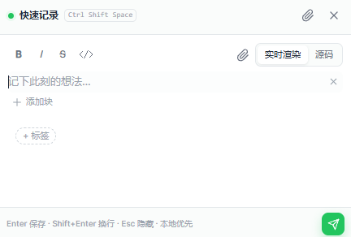

# memo

**本地优先的桌面速记，可选归档到 Notion。**

[English](README.en.md) | 简体中文

[](https://github.com/olianate/memo/releases/latest)  
[](https://github.com/olianate/memo/actions/workflows/release.yml)


## 功能

- 打开即写，`Enter` 保存，`Shift+Enter` 换行；Markdown 实时预览
- `Ctrl+Shift+Space` 全局快速记录，`Esc` 隐藏
- 标签、附件、本地搜索、统计、置顶、回收站（30 天自动清理）
- 托盘常驻、单实例；数据存在本地 SQLite，离线可用
- 可选 Notion 归档：schema 检查、同步暂停、正文保留策略

| 编辑笔记 | 快速记录 |
| --- | --- |
|  |  |


## 下载

[最新版 Releases](https://github.com/olianate/memo/releases/latest)

- Windows x64：[MSI](https://github.com/olianate/memo/releases/latest/download/memo-windows-amd64.msi)（推荐） / [NSIS 安装包](https://github.com/olianate/memo/releases/latest/download/memo-windows-amd64-installer.exe)
- macOS Intel / Apple Silicon：[Universal DMG](https://github.com/olianate/memo/releases/latest/download/memo-macos-universal.dmg)

安装包未签名：Windows 首次运行需 SmartScreen「仍要运行」，macOS 需右键 → 打开。Windows 需要 WebView2，macOS 需要 12+。

## 使用

顶部输入框写笔记，`#标签` 添加标签；点击卡片编辑正文、标签和附件，或移到回收站。关闭主窗口后应用留在托盘，左键托盘图标恢复。

数据在 Windows `%APPDATA%\memo`、macOS `~/Library/Application Support/memo`；卸载不会删除，可用 **设置 → 删除全部本地数据** 清除。启动失败会弹窗说明原因并写入 `logs/memo.log`。

## Notion（可选）

创建 integration 并把目标页面或数据库分享给它，然后在 **设置 → 连接 Notion** 粘贴 token。token 保存在系统钥匙串，不写入 SQLite 或日志；细节见 [`docs/development.md`](docs/development.md)。

## 构建

需要 Go 1.26+、Node.js 24+ 和 Wails v3 CLI（`go install github.com/wailsapp/wails/v3/cmd/wails3@v3.1.0`）；打包 MSI / NSIS / DMG 另需 WiX 3.14 / NSIS / Xcode Command Line Tools。

```bash
go test ./internal/... ./tools/...
( cd frontend && npm ci && npm test && npx tsc --noEmit )

wails3 dev     # 热重载
wails3 build   # 生产构建
```

## 文档

开发与打包见 [`docs/development.md`](docs/development.md)，发版见 [`docs/releasing.md`](docs/releasing.md)；另有 [术语表](GLOSSARY.md)、[架构决策](docs/adr/)、[发布前检查清单](SMOKE.md) 和 [第三方许可](NOTICE)。

## 许可证

[MIT](LICENSE)
