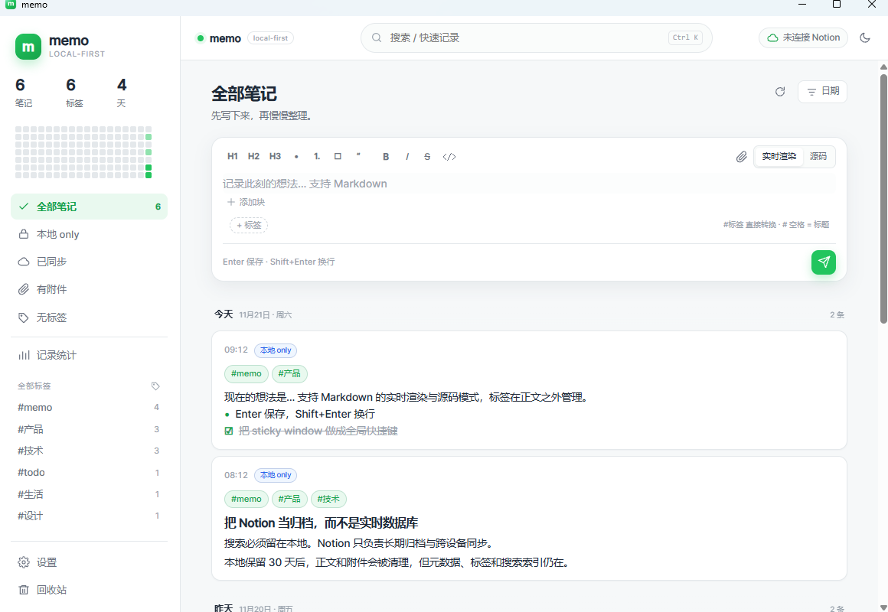
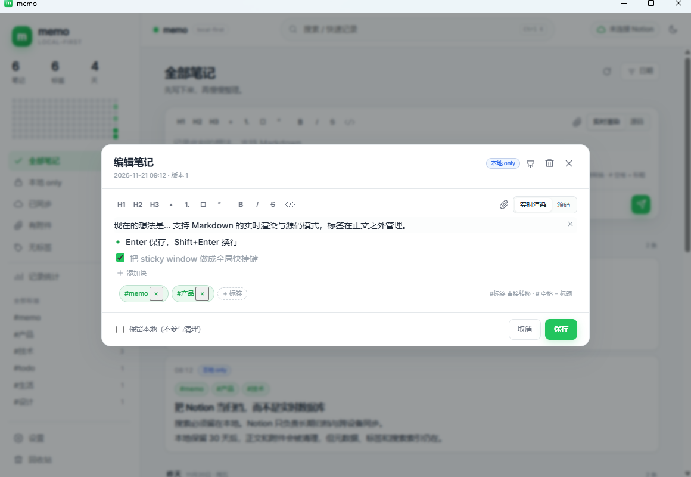
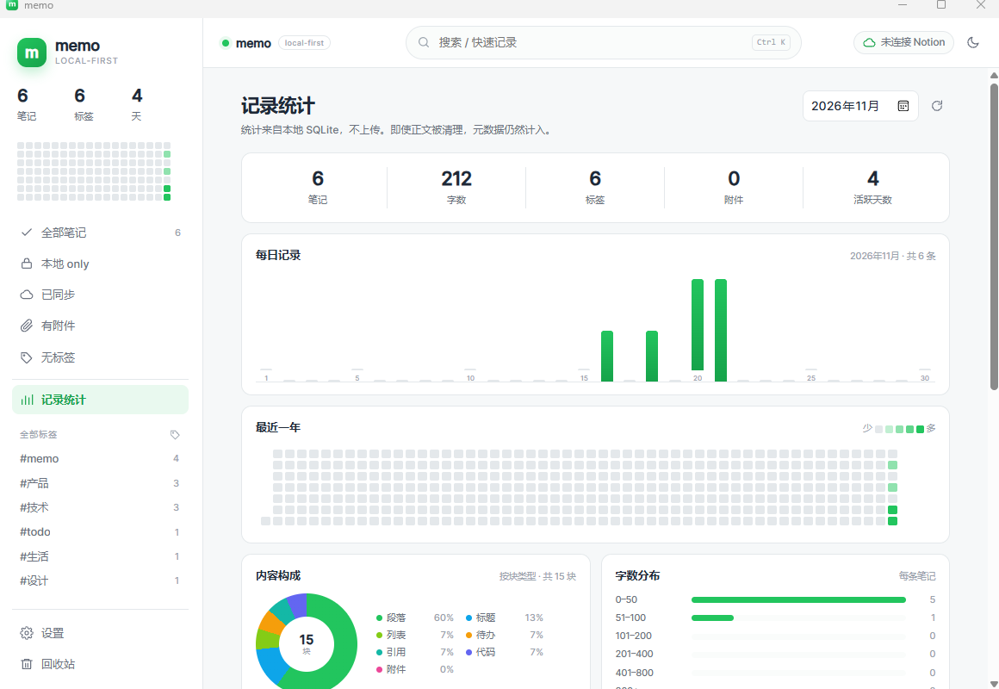

# memo

**本地优先的桌面速记，可选归档到 Notion。**

[English](README.en.md) | 简体中文

[](https://github.com/olianate/memo/releases/latest)
[](https://github.com/olianate/memo/actions/workflows/release.yml)



memo 是一个本地优先的桌面速记应用。笔记、搜索、标签和统计都存在本地 SQLite 中，
离线可用；可选连接 Notion，把笔记长期归档到自己的数据库。

## 功能

- 打开即写，`Enter` 保存，`Shift+Enter` 换行
- `Ctrl+Shift+Space` 全局快速记录，`Esc` 隐藏
- Markdown 块、标签、附件、本地搜索
- 回收站、托盘常驻、单实例
- 可选 Notion 归档，支持 schema 检查、同步暂停和正文保留策略

| 编辑笔记 | 快速记录 |
| --- | --- |
|  |  |



## 下载

最新版：[**Releases**](https://github.com/olianate/memo/releases/latest)

| 平台 | 安装包 |
| --- | --- |
| Windows x64 | [memo-windows-amd64.msi](https://github.com/olianate/memo/releases/latest/download/memo-windows-amd64.msi)（推荐） |
| Windows x64 | [memo-windows-amd64-installer.exe](https://github.com/olianate/memo/releases/latest/download/memo-windows-amd64-installer.exe) |
| macOS Intel / Apple Silicon | [memo-macos-universal.dmg](https://github.com/olianate/memo/releases/latest/download/memo-macos-universal.dmg) |

Windows 两个安装包任选其一。安装包未签名、未公证，首次打开可能需要 SmartScreen
“更多信息 → 仍要运行”或 macOS 右键 → 打开。Windows 需要 WebView2，macOS 需要 12+。

卸载不会删除 `%APPDATA%\memo` 中的数据；需要清除时使用 **设置 → 删除全部本地数据**。

## 使用

1. 在顶部输入框写笔记，输入 `#标签` 添加标签。
2. 点击卡片编辑正文、标签和附件，或移到回收站。
3. 关闭主窗口后应用留在托盘，左键托盘图标恢复。

数据位置：Windows `%APPDATA%\memo`，macOS `~/Library/Application Support/memo`。

## Notion（可选）

1. 创建 Notion integration，复制 token。
2. 把目标页面或数据库分享给 integration。
3. 在 **设置 → 连接 Notion** 粘贴 token，选择数据库或页面。
4. 已有数据库会先检查 schema：只追加缺失属性，类型冲突会阻止连接。

token 保存在系统钥匙串，不会写入 SQLite 或日志。细节见
[`docs/development.md`](docs/development.md)。

## 构建

需要 Go 1.26+、Node.js 24+、Wails v3 CLI（`go install github.com/wailsapp/wails/v3/cmd/wails3@v3.1.0`）。
Windows MSI 需要 WiX 3.14，NSIS 安装包需要 NSIS，macOS 需要 Xcode Command Line Tools。

```bash
go test ./internal/...

cd frontend
npm ci
npm test
npx tsc --noEmit
cd ..

wails3 dev
wails3 build

wails3 package INSTALL_SCOPE=user
./build/windows/msi/build.ps1 -Version 1.0.0 -WixDir <WiX 3.14 目录>

wails3 task darwin:package:universal
wails3 task darwin:create:dmg
```

Wails v3.1.0 固定在 `third_party/wails`，包含 Windows IME 修复补丁。

## 发布

```bash
git tag v1.0.0
git push origin v1.0.0
```

`.github/workflows/release.yml` 会运行测试，构建 Windows MSI/NSIS 和 macOS 通用 DMG，
生成 `SHA256SUMS.txt` 并发布 GitHub Release。

## 文档

- [`docs/development.md`](docs/development.md)：实现、Notion 行为和打包细节
- [`GLOSSARY.md`](GLOSSARY.md)：领域术语
- [`docs/adr/`](docs/adr/)：架构决策记录
- [`SMOKE.md`](SMOKE.md)：发布前人工检查清单

## 许可证

[MIT](LICENSE)
